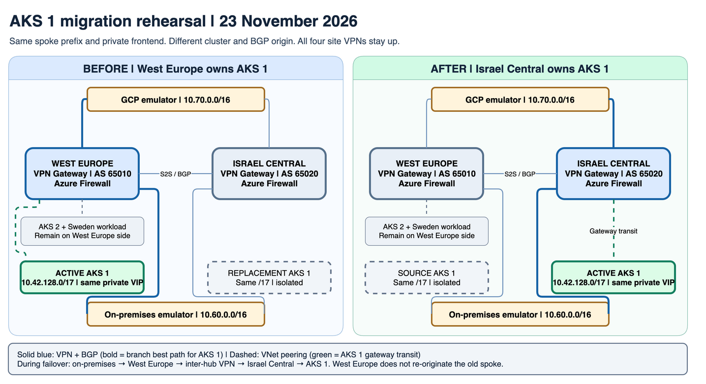
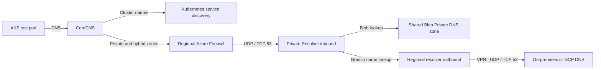

# AKS 1 regional migration — lab report

**Rehearsed:** 23 November 2026

**Result:** The cutover passed the private HTTP and DNS checks and left AKS 1 active in Israel Central. A separate on-premises BGP failover drill verified the backup path through West Europe.

## 1. Deployed topology: before and after

[Editable Draw.io diagram](./architecture/06-aks1-rehearsal.drawio)

The diagram compares the redesigned lab immediately before and after the successful cutover. On-premises and GCP are separate Azure-hosted emulators, not production networks. Each has a router, a DNS server, and a private HTTP probe. Each router has a site-to-site IPsec/BGP connection to **both** Azure hubs. The hubs have a direct BGP VPN; Sweden Central connects to West Europe by **Global VNet Peering**, not VPN.

| Component | Before | After |
|---|---|---|
| AKS 1 spoke `10.42.128.0/17` | West Europe origin, AS `65010` | Israel Central origin, AS `65020` |
| AKS 1 node subnet and application frontend | `10.42.129.0/24`; private load balancer | Same subnet range and same private frontend IP, on a separate cluster |
| Inactive copy of the `/17` | Israel replacement isolated | West Europe source isolated |
| AKS 2 `10.43.0.0/17` and Sweden workload `10.44.1.0/24` | West Europe side | Unchanged |
| Branch VPNs | Four links configured | All four retained; no VPN retirement |

This was a **network and stateless test workload rehearsal**. The Kubernetes pod did not move between clusters; the same test manifest ran as two separate pod instances. F5 and production application or data migration were out of scope.

## 2. BGP and packet routing

| Phase | Selected route to AKS 1 from the branch routers | Meaning |
|---|---|---|
| Before cutover | Direct West Europe, AS path `65010` | West Europe originates the prefix through gateway transit. |
| Withdrawal gate | No `/17` at either Azure gateway | Break-before-make: no overlapping route ownership. |
| After cutover | Direct Israel Central, `65020` | Both branch routers selected the shorter direct path. |
| On-premises failover | West Europe, `65010 65020` | West Europe relays Israel's route over the inter-hub VPN. This is not a second origin. |
| Failback | Direct Israel Central, `65020` | The direct session was restored. |

The cutover moved the spoke's hub and management peerings. **Deleting the source peering alone was insufficient:** the source `GatewaySubnet` user-defined route (UDR) still caused West Europe to advertise the `/17`. Remove that UDR, verify withdrawal from both gateways, then attach the Israel spoke and install the destination gateway UDR. Reverse that sequence for rollback.

### How the tested flows were steered

| Flow | Path | Evidence |
|---|---|---|
| Pod → on-premises / GCP (TCP 80) | Pod → node → active regional firewall → regional VPN gateway → branch | Pod HTTP 200 and firewall allow logs for both destinations; branch forwarding tables showed the direct Israel return path after cutover. |
| Pod → regional web probes (TCP 80) | Node subnet UDR → active regional firewall; remote paths use the inter-hub VPN or West Europe–Sweden peering as applicable | All five private probes passed. Israel Firewall logged all five after cutover; West Europe Firewall also logged requests to the West Europe and Sweden probes. Sweden captured the HTTP exchange with the node's private source IP. |
| Branch → AKS 1 private VIP (TCP 80) | Branch VPN → Azure gateway → GatewaySubnet UDR → regional firewall → private frontend | Both Windows branch clients obtained HTTP 200 after migration and after failback. |
| Israel pod → public HTTPS (TCP 443) | Node subnet default route → Israel Firewall → public destination | After migration, AKS changed to `userDefinedRouting`. The allowlisted HTTPS probe returned 200 and Israel Firewall logged `Allow`. West Europe public egress mode was not changed. |

Azure CNI Overlay translates traffic leaving the cluster from the pod IP to the node's private IP. Private routing and firewall rules therefore use the **node subnet**, not the pod overlay range or the private ingress VIP. For the tested public egress flow, Azure Firewall provides the public source address. The UDRs steer both directions of the tested private flows; a default route alone does not override more-specific routes.

## 3. DNS: two distinct query legs

CoreDNS keeps Kubernetes service discovery local and forwards the selected zones to the regional DNS Private Resolver inbound endpoint: `10.42.2.4` before cutover, `10.42.18.4` afterward. The resolver answers Blob lookups from the linked shared private zone. For branch names, the outbound endpoint sends a **new** query to the appropriate emulator DNS server.

Both regional resolver outbound subnets can reach the designated branch DNS servers on UDP/TCP 53 over routed paths. The verified design does not use emulator DNS SNAT. AKS Overlay SNAT for workload traffic is unchanged.

## 4. Test results

### Private HTTP from the AKS pod

| Probe | West Europe, before cutover | Israel Central, after cutover |
|---|---|---|
| On-premises `10.60.0.12` | 200 | 200 |
| GCP `10.70.0.12` | 200 | 200 |
| West Europe `10.43.2.10` | 200 | 200 |
| Sweden Central `10.44.1.5` | 200 | 200 after route convergence |
| Israel Central regional probe | 200 | 200 |
| AKS 1 private frontend (control) | Same frontend retained | 200 |

### DNS from the AKS pod

| Query | West Europe, before cutover | Israel Central, after cutover |
|---|---|---|
| `web.onprem.lab.internal` | `10.60.0.12` | `10.60.0.12` |
| `web.gcp.lab.internal` | `10.70.0.12` | `10.70.0.12` |
| West Europe, Sweden, and Israel Blob account names under `blob.core.windows.net` | All three returned the expected private endpoint addresses | All three returned the expected private endpoint addresses |

### Failover and recovery

From **14:21 to 14:24 UTC**, the on-premises router's direct **BGP session** to Israel was administratively stopped. Its selected path changed to West Europe and then crossed the inter-hub VPN to the active Israel spoke. **Five sampled requests returned HTTP 200** during the event. An automatic restore timer brought the session back; both branch routers again selected direct Israel, and both branch clients returned HTTP 200 after failback.

This demonstrates a working **BGP backup path** for the measured flow, not zero interruption. It does not validate physical IPsec loss, a full region outage, independent GCP failover, or automatic DNS resolver failover. Private Blob DNS responses are not proof of Blob data-plane access. The smoke application used HTTP, not production TLS.

## 5. Repeat the rehearsal safely

1. Establish a passing baseline with the same `lab-curl` test pod definition in both clusters. Record UTC timestamps, pod and region, DNS answers, HTTP status, effective routes, and firewall logs.
2. With the destination spoke isolated, verify its regional DNS path independently and check the replacement application locally.
3. Use the [AKS cutover Terraform root](./infra/aks1-cutover/) and enforce the gateway UDR withdrawal gate. Check both branch routers, not just Azure provisioning status.
4. Repeat the same HTTP and DNS matrix from the replacement pod. Test the private VIP from both branch clients. Check fresh flow logs before calling inspection a pass.
5. Test failover with a timed restore and verify failback. On regression, detach and withdraw the destination before reattaching the source.

**Operational caveat:** Some routing and DNS changes were applied directly. Reconcile Terraform state and region-specific inputs before a full regional apply; with Israel active, West Europe must not reinstall its local `/17` gateway route. Preserve the runner-only secret inputs outside Git. See the [runbook](./LAB-RUNBOOK.md) for operational details and the [bill of materials](./LAB-BOM.md) for the original design scope.
