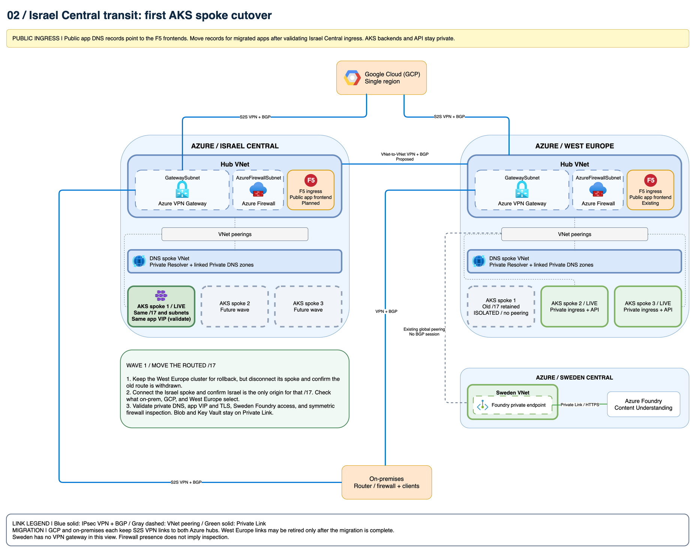

# Multi-region AKS networking lab

Test what changes when a hybrid environment with one Azure region and one GCP region adds a second Azure region. The lab separates four questions: **Can traffic reach the destination? Does Azure Firewall actually inspect it? Does DNS return the right address? Where does AKS ingress and egress traffic flow?**

Start with the [lab runbook](./LAB-RUNBOOK.md) for the build order, expected results, and rollback tests. This repository documents the lab; it does not provision infrastructure.

## Starting and target topologies

### Current state: West Europe transit


[Editable Draw.io diagram](./architecture/01-current-west-europe.drawio)

### Israel Central: first AKS spoke cutover



[Editable Draw.io diagram](./architecture/02-israel-central-first-spoke-cutover.drawio)

### Animated BGP cutover


[Open the animation on its own](./architecture/03-prefix-cutover-animation.svg). Follow `10.42.128.0/17` to both peers and watch their route labels change from West Europe to withdrawn to Israel Central. All four VPN links stay up.

**Starting state:** West Europe connects to on-prem and a single GCP region using site-to-site (S2S) VPN with BGP. The hub VNet contains Azure VPN Gateway, Azure Firewall, and F5 ingress. All public application DNS records resolve to the West Europe F5 ingress frontend. A separate DNS spoke contains Azure DNS Private Resolver and is linked to Private DNS zones; three AKS spoke VNets peer with the hub. West Europe also has global VNet peering to Sweden Central for Azure Foundry Content Understanding. The AKS API and backends stay private, and Foundry, Blob Storage, and Key Vault use private endpoints.

**During migration:**

```text
On-prem and GCP each --- S2S VPN / BGP --- Israel Central
On-prem and GCP each --- S2S VPN / BGP --- West Europe
Israel Central --- proposed VNet-to-VNet VPN / BGP --- West Europe
West Europe --- Global VNet peering --- Sweden Central
```

Israel Central mirrors the West Europe design: VPN Gateway, Firewall, and a new F5 ingress in the hub, a separate DNS spoke with Private Resolver, and three AKS spokes by the end of the migration. On-prem and GCP each connect directly to **both Azure hubs** throughout the migration. Consider retiring the direct West Europe links only after the migration is complete and the remaining paths have been validated. One logical site connection can still have multiple tunnels for redundancy.

### Inter-region link and Sweden decision

- **VNet-to-VNet VPN with BGP** is the proposed Israel–West Europe link because both hubs keep their own gateways and customer wants route exchange between those gateways.
- **Global VNet peering** is an alternative, not a BGP session. Peerings aren't transitive, and a VNet with its own gateway can't use a peered VNet's remote gateway. A peering-only design must explicitly account for spoke and external transit rather than swapping only the hub link.
- **Sweden is not a BGP peer in either diagram.** If the West Europe–Sweden peering uses gateway transit and Sweden can use the remote gateway, verify whether West Europe advertises the Sweden VNet prefix and whether Sweden has return routes, including to the moved spoke. If Sweden must exchange routes over its own BGP session, explicitly design a Sweden gateway and VPN. Test Foundry resolution and HTTPS from the Israel AKS workload in either case. See [Azure VNet peering](https://learn.microsoft.com/en-us/azure/virtual-network/virtual-network-peering-overview) and [cross-region gateway use](https://learn.microsoft.com/en-us/azure/vpn-gateway/vpn-gateway-different-region).

### One AKS spoke at a time: move the `/17`, not the original cluster

1. **Stage the replacement in isolation.** Recreate the first spoke's `/17` and subnets in Israel and build a replacement AKS cluster and app. Keep the identical prefixes disconnected from any common routed network during staging. Provide an isolated management path and a way to satisfy DNS, image, and egress dependencies; prove that path in the lab before relying on an isolated build.
2. **Transfer reachability.** Disconnect the old spoke from all shared routes and check that West Europe stops originating the `/17` (also check static routes, summaries, and more-specific routes). Keep the old VNet and AKS resource for rollback. Connect the new spoke with the required gateway transit, then verify the exact `/17` is originated by Israel only. Check on-prem, GCP, West Europe, and Sweden as applicable. Expect a cutover window; keeping the old resource does not preserve connectivity. For rollback, withdraw and isolate Israel before restoring West Europe.
3. **Prove the address and policy assumptions.** For a client-facing AKS internal load balancer, request the old private VIP in the new subnet if it is available and supported by the frontend. A recreated cluster's private API endpoint, node/pod IPs, and other private endpoint IPs are separate and do not automatically retain their old values. Keeping CIDRs and the app VIP helps preserve IP-based rules, but verify rule objects, source addresses/SNAT, DNS, and the actual inspection path in both directions. Recheck the two live West Europe spokes before repeating. See [AKS internal load balancer](https://learn.microsoft.com/en-us/azure/aks/internal-lb).

## Routing and inspection

### End-to-end BGP paths

Use route-based VPNs with BGP on all four external links and the proposed Israel–West Europe VNet-to-VNet VPN. Use distinct ASNs on the two Azure hubs and check for ASN reuse in transit. For AKS and DNS spokes that need gateway routes, enable **Allow gateway transit** on the hub side and **Use remote gateways** on the spoke side. Keep BGP route propagation enabled for the BGP-only baseline. Use Cloud Router for GCP.

| Flow | Intended path during migration |
|---|---|
| On-premises or GCP to AKS 2 or 3 | Prefer the direct West Europe tunnel: site -> West Europe VPN Gateway -> local AKS spoke. Return to the site through the same hub. |
| On-premises or GCP to AKS 1 (`10.42.128.0/17`) | Before cutover, use the direct West Europe tunnel. Withdraw only AKS 1's route and verify its removal at both sites before Israel Central originates the same `/17`. Then prefer the direct Israel tunnel in both directions. All four VPN links stay up. |
| Israel Central AKS to West Europe AKS or DNS, and back | Source spoke -> local VPN Gateway -> inter-region VPN -> remote VPN Gateway -> destination spoke. Verify each hub learns the other hub's required spoke prefixes. Hub peering alone does not provide spoke-to-spoke transit. |
| Israel Central AKS to the Sweden Foundry private endpoint, and back | Intended path: Israel hub -> inter-region VPN -> West Europe hub -> Sweden via existing Global VNet Peering. Verify that West Europe advertises the Sweden prefix, Israel learns it, and Sweden has a return route to Israel through supported gateway transit. Sweden has no BGP session. If those routes aren't present, design an explicit supported path before cutover. |

After cutover, West Europe may still re-advertise an Israel-learned **transit path** to `10.42.128.0/17`; that is not the same as West Europe originating the old spoke route. Verify route selection at on-premises and GCP rather than assuming the direct path wins. Check for covering summaries, more-specific routes, unintended equal-cost paths, and asymmetry. Compare each gateway's advertised and learned routes with the effective next hops on the workload subnets.

### Where to put UDRs

**No UDR is needed for BGP exchange or basic reachability** when the expected routes propagate correctly. BGP does not insert Azure Firewall. For an inspected flow, configure the forward and return paths through the same stateful firewall. See [Azure Firewall hybrid routing](https://learn.microsoft.com/en-us/azure/firewall/tutorial-hybrid-portal-policy) and [Azure route selection](https://learn.microsoft.com/en-us/azure/virtual-network/virtual-networks-udr-overview).

| Where | UDR when inspection is required |
|---|---|
| Destination hub's `GatewaySubnet` | For VPN-to-local-spoke inspection, route each **local destination** spoke prefix to the local Azure Firewall private IP (`Virtual appliance`). Keep gateway route propagation enabled; do not put a `0.0.0.0/0` UDR here. Remove or adjust any stale West Europe local-spoke UDR for `10.42.128.0/17` and add the Israel equivalent if inspection is required. |
| AKS or DNS spoke subnet carrying the return flow | Route the relevant on-premises, GCP, or remote-region destination prefixes to the **local** firewall. With BGP propagation enabled, use specific routes that match the effective BGP prefixes: a `0.0.0.0/0` UDR does not beat a more-specific BGP route. Apply the route table to the subnet that actually carries the traffic, which depends on the AKS networking mode. |
| Azure Firewall subnet | No blanket UDR for the hybrid transit baseline. Verify that the firewall can reach local spokes and that it learns the required remote prefixes via the gateway. Treat internet forced tunneling separately. |
| F5 and private endpoints | VPN UDRs do not automatically inspect these flows. Verify the F5 backend and return next hops, accounting for proxying or SNAT. For private endpoint traffic, check effective routes and route-table network policies before adding overrides. |

Example: `on-premises -> Israel VPN Gateway -> Israel Azure Firewall -> AKS 1`; the response must return `AKS 1 -> same firewall -> Israel VPN Gateway -> on-premises`. For cross-region inspection, decide which firewall inspects the flow and validate both directions before extending the UDR pattern. If mandatory private inspection without workload UDRs is required, evaluate Standard Azure Virtual WAN with Azure Firewall and Private Traffic Routing Intent separately.

## Address plan: a `/17` AKS spoke

**An AKS spoke VNet can use a `/17`; AKS does not require a `/16`.** For the migration test, use `10.42.128.0/17` as the example spoke VNet address space and `10.42.129.0/24` as an example node subnet within it. Stage the same `/17` in Israel Central in isolation. Keep all four site-to-site VPN links up, verify that on-premises and GCP no longer learn the `/17` from West Europe, and then originate it from Israel Central.

The shared `10.42.0.0/16` is an IPAM planning block, not a VNet spanning both regions. It contains only two non-overlapping `/17`s, so it cannot fit three `/17` spokes. Confirm the actual allocations for all spokes, hubs, DNS VNets, and Sweden.

### Smaller examples for basic transit tests

The `/24` spoke examples below are for basic transit tests only; they do not represent the `/17` cutover.

| Allocation | Planning block | Example networks |
|---|---|---|
| West Europe | `10.42.0.0/20` | Hub `10.42.0.0/24`; AKS spoke `10.42.1.0/24` |
| Israel Central | `10.42.16.0/20` | Hub `10.42.16.0/24`; AKS spoke `10.42.17.0/24` |
| Emulated on-prem | Outside the Azure parent | `10.60.0.0/24` |
| GCP VPC subnet | Outside the Azure parent | `10.70.0.0/24` |

If a connected West Europe VNet already **has** the full `/16` configured, resolve the overlap before connecting the new `/17` spoke; unused addresses are still part of that VNet. A `/16` **BGP summary** is a separate issue: check whether it would still attract traffic to West Europe after the `/17` is withdrawn.

Check for overlap with on-premises and GCP ranges. Size the node, pod, and service ranges for expected scale and upgrade surge. With Azure CNI Overlay, pods use a separate CIDR; with Azure CNI Pod Subnet, pods consume VNet addresses. See [Azure VNet address-space rules](https://learn.microsoft.com/en-us/azure/virtual-network/virtual-networks-faq) and [AKS IP address planning](https://learn.microsoft.com/en-us/azure/aks/concepts-network-ip-address-planning).

## DNS across West Europe, Israel Central, and Sweden Central



[Static diagram](./architecture/04-onprem-blob-dns.png) · [Interactive walkthrough](./architecture/04-onprem-blob-dns.html) — download the HTML file and open it in a browser to replay all three queries through either resolver.

Deploy one Azure DNS Private Resolver in the West Europe DNS spoke and another in Israel Central's DNS spoke. Link **the same Private DNS zone resources** to both resolver VNets: private application zones, the relevant AKS private API zones, and the Private Link zones for Foundry, Blob Storage, and Key Vault. Both resolvers can return the private IP for Sweden Foundry without forwarding the DNS query to Sweden. For Private Link, follow the [service-specific conditional forwarding guidance](https://learn.microsoft.com/en-us/azure/private-link/private-endpoint-dns-integration); where required, forward the service's **public DNS zone** so Azure can follow the public-to-private CNAME chain.

### Migrate the existing on-premises forwarder

For Blob Storage, configure one `blob.core.windows.net` conditional forwarder on the single on-premises DNS server. The addresses below are illustrative:

| Role during migration | Azure Private Resolver inbound endpoint |
|---|---|
| Preferred | West Europe (`10.42.2.4`) |
| Fallback | Israel Central (`10.42.18.4`) |

Both targets use the same `privatelink.blob.core.windows.net` zone and can resolve Blob accounts in West Europe, Sweden Central, and Israel Central. The fallback is for an unresponsive resolver or VPN path, not for an account hosted in a different region. The animation lets you select the fallback manually; verify automatic retry on your actual DNS server. The single on-premises DNS server remains a single point of failure.

1. **Today:** Clients query the on-premises forwarder, which sends matching Azure queries to the West Europe inbound resolver IP. Leave that path in place.
2. **Before cutover:** Deploy the Israel inbound endpoint and link the zones to both resolver VNets. Query each endpoint directly over its regional tunnel for names in all three regions. Verify the returned IP and test the actual service separately. Don't add Israel as a target until it answers correctly; an `NXDOMAIN` reply does not reliably trigger failover.
3. **During migration:** Add Israel Central as a second target for the same conditional forwarders. Prefer West Europe initially if the forwarder supports it; otherwise test how it selects and retries targets. Test UDP and TCP 53 over both paths and simulate losing each endpoint in turn. Either healthy resolver should answer for all three regions.
4. **Per application:** If the private VIP stays the same, BGP changes the path without requiring an app DNS change. If the VIP or AKS private API endpoint changes, update the applicable private record and allow for TTL and negative caching. Moving public app records to the Israel F5 is separate.
5. **After migration:** Keep both targets if regional DNS failover is required. If the West Europe VPN is retired later, first prove its inbound endpoint is reachable through an independent alternate path, or replace or remove that target.

### How VMs and pods resolve remote resources

| Query direction | Design |
|---|---|
| Israel Central VMs and AKS pods -> West Europe or Sweden private names | Configure the workload VNets to use the Israel inbound endpoint as custom DNS. Pods use CoreDNS; external names follow the cluster's upstream DNS to that endpoint. The linked zones return the West Europe or Sweden private IP. |
| West Europe VMs and AKS pods -> Israel or Sweden private names | Use the West Europe inbound endpoint in the same way. Shared zones return Israel and Sweden records locally. |
| Sweden workloads -> West Europe or Israel private names | Use Azure-provided DNS and link the required private zones to the Sweden workload VNet. Alternatively, configure Sweden to use the West Europe inbound endpoint over verified peering reachability. Sweden does not need its own resolver for shared Azure private zones. |
| Azure workloads -> on-prem or GCP names | Link an outbound forwarding ruleset to each resolver's DNS spoke VNet in this centralized design. Forward only the relevant suffixes to on-premises DNS servers or GCP Cloud DNS inbound forwarding IPs. Sweden needs a reachable centralized resolver path for these forwarded namespaces; direct zone links alone only provide the linked zones. |
| On-prem or GCP -> Azure private names | Configure conditional forwarding for the applicable Azure suffixes to reachable Azure inbound endpoints. For default GCP Cloud DNS private forwarding, verify the `35.199.192.0/19` return route and UDP/TCP 53 policy. |

Avoid duplicate private zones for the same namespace and don't forward queries back to the same inbound endpoint. Use shared application FQDNs across clusters rather than another cluster's `*.svc.cluster.local` names. Test from an on-premises client and from a pod in each AKS region: first DNS resolution and the returned IP, then HTTPS/TLS and the return path. A correct answer does not prove that BGP, UDRs, or firewalls allow the connection.

## Application ingress and egress

- **Public ingress:** Keep public application records on the West Europe F5 until each app is ready to cut over. Validate the Israel Central F5 frontend for the app hostname, TLS, and reachability to the private AKS backend before changing its public DNS record. Leave apps that have not migrated on the West Europe F5. The `/17` BGP cutover does not update public DNS.
- **Private ingress:** Start with a simple HTTPS echo service in each cluster behind an Azure internal load balancer. Add a private Gateway/Ingress frontend later if host-based routing is part of the test; use its actual private frontend IP for the DNS record. Return a region identifier from each backend to prove which region served the request. Test the application endpoint separately from the private AKS API.
- **Private egress:** Test pods in both regions reaching controlled on-prem and GCP endpoints. Record the observed source IP; for example, Azure CNI Overlay SNATs traffic leaving the cluster to the node IP. Check routes, return paths, and firewall logs separately for each direction.
- **Internet egress:** Pick and document the AKS outbound type. If the lab must match the no-public-workload-IP constraint, do not use a `loadBalancer` outbound baseline that creates a public IP; use the approved egress path or a supported network-isolated configuration. If preserving firewall-controlled egress via AKS `userDefinedRouting`, document the required route separately from BGP transit. Confirm AKS dependencies remain reachable and measure the observed source IP for any approved egress.

## References

- [Azure VPN Gateway BGP transit](https://learn.microsoft.com/en-us/azure/vpn-gateway/configure-bgp), [BGP route behavior](https://learn.microsoft.com/en-us/azure/vpn-gateway/vpn-gateway-bgp-overview), and [peering gateway transit](https://learn.microsoft.com/en-us/azure/vpn-gateway/vpn-gateway-peering-gateway-transit)
- [Azure Firewall hybrid routing](https://learn.microsoft.com/en-us/azure/firewall/tutorial-hybrid-portal) and [Virtual WAN Routing Intent](https://learn.microsoft.com/en-us/azure/virtual-wan/how-to-routing-policies)
- [Azure DNS Private Resolver architecture](https://learn.microsoft.com/en-us/azure/dns/private-resolver-architecture), [endpoints and regional rulesets](https://learn.microsoft.com/en-us/azure/dns/private-resolver-endpoints-rulesets), and [cross-region DNS failover](https://learn.microsoft.com/en-us/azure/dns/tutorial-dns-private-resolver-failover)
- [Google Cloud HA VPN to Azure](https://docs.cloud.google.com/network-connectivity/docs/vpn/tutorials/create-ha-vpn-connections-google-cloud-azure) and [Cloud DNS forwarding zones](https://docs.cloud.google.com/dns/docs/zones/zones-overview)
- [Private AKS API](https://learn.microsoft.com/en-us/azure/aks/private-clusters), [AKS internal load balancer](https://learn.microsoft.com/en-us/azure/aks/internal-lb), [Azure CNI Overlay](https://learn.microsoft.com/en-us/azure/aks/azure-cni-overlay), and [AKS outbound types](https://learn.microsoft.com/en-us/azure/aks/egress-outboundtype)
