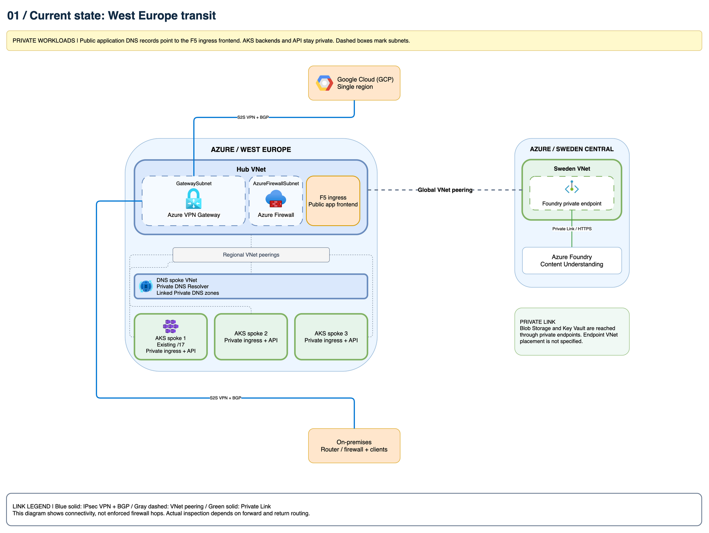

# Multi-region AKS networking lab

Test what changes when a hybrid environment with one Azure region and one GCP region adds a second Azure region. The lab separates four questions: **Can traffic reach the destination? Does Azure Firewall actually inspect it? Does DNS return the right address? Where does AKS ingress and egress traffic flow?**

Start with the [lab runbook](./LAB-RUNBOOK.md) for the build order, expected results, and rollback tests. This repository documents the lab; it does not provision infrastructure.

## Starting and target topologies

### Current state: West Europe transit



[Editable Draw.io diagram](./architecture/01-current-west-europe.drawio)

### Israel Central: first AKS spoke cutover


[Editable Draw.io diagram](./architecture/02-israel-central-first-spoke-cutover.drawio)

### Animated BGP cutover



[Open the animation on its own](./architecture/03-prefix-cutover-animation.svg). Follow `10.42.128.0/17` to both peers and watch their route labels change from West Europe to withdrawn to Israel Central. All four VPN links stay up.

**Starting state:** West Europe connects to on-prem and a single GCP region using site-to-site (S2S) VPN with BGP. The hub VNet contains Azure VPN Gateway, Azure Firewall, and F5 ingress. All public application DNS records resolve to the West Europe F5 ingress frontend. A separate DNS spoke contains Azure DNS Private Resolver and is linked to Private DNS zones; three AKS spoke VNets peer with the hub. West Europe also has global VNet peering to Sweden Central for Azure Foundry Content Understanding. The AKS API and backends stay private, and Foundry, Blob Storage, and Key Vault use private endpoints.

**During migration:**

```text
On-prem and GCP each --- S2S VPN / BGP --- Israel Central
On-prem and GCP each --- S2S VPN / BGP --- West Europe
Israel Central --- proposed VNet-to-VNet VPN / BGP --- West Europe
West Europe --- Global VNet peering --- Sweden Central
```

Israel Central mirrors the West Europe design: VPN Gateway, Firewall, and a new F5 ingress in the hub, a separate DNS spoke with Private Resolver, and three AKS spokes by the end of the migration. On-prem and GCP each connect directly to **both Azure hubs** throughout the migration. Consider retiring the direct West Europe links only after the migration is complete and the remaining paths have been validated. One logical site connection can still have multiple tunnels for redundancy.

### Inter-region link and Sweden decision

- **VNet-to-VNet VPN with BGP** is the proposed Israel–West Europe link because both hubs keep their own gateways and customer wants route exchange between those gateways.
- **Global VNet peering** is an alternative, not a BGP session. Peerings aren't transitive, and a VNet with its own gateway can't use a peered VNet's remote gateway. A peering-only design must explicitly account for spoke and external transit rather than swapping only the hub link.
- **Sweden is not a BGP peer in either diagram.** If the West Europe–Sweden peering uses gateway transit and Sweden can use the remote gateway, verify whether West Europe advertises the Sweden VNet prefix and whether Sweden has return routes, including to the moved spoke. If Sweden must exchange routes over its own BGP session, explicitly design a Sweden gateway and VPN. Test Foundry resolution and HTTPS from the Israel AKS workload in either case. See [Azure VNet peering](https://learn.microsoft.com/en-us/azure/virtual-network/virtual-network-peering-overview) and [cross-region gateway use](https://learn.microsoft.com/en-us/azure/vpn-gateway/vpn-gateway-different-region).

### One AKS spoke at a time: move the `/17`, not the original cluster

1. **Stage the replacement in isolation.** Recreate the first spoke's `/17` and subnets in Israel and build a replacement AKS cluster and app. Keep the identical prefixes disconnected from any common routed network during staging. Provide an isolated management path and a way to satisfy DNS, image, and egress dependencies; prove that path in the lab before relying on an isolated build.
2. **Transfer reachability.** Disconnect the old spoke from all shared routes and check that West Europe stops originating the `/17` (also check static routes, summaries, and more-specific routes). Keep the old VNet and AKS resource for rollback. Connect the new spoke with the required gateway transit, then verify the exact `/17` is originated by Israel only. Check on-prem, GCP, West Europe, and Sweden as applicable. Expect a cutover window; keeping the old resource does not preserve connectivity. For rollback, withdraw and isolate Israel before restoring West Europe.
3. **Prove the address and policy assumptions.** For a client-facing AKS internal load balancer, request the old private VIP in the new subnet if it is available and supported by the frontend. A recreated cluster's private API endpoint, node/pod IPs, and other private endpoint IPs are separate and do not automatically retain their old values. Keeping CIDRs and the app VIP helps preserve IP-based rules, but verify rule objects, source addresses/SNAT, DNS, and the actual inspection path in both directions. Recheck the two live West Europe spokes before repeating. See [AKS internal load balancer](https://learn.microsoft.com/en-us/azure/aks/internal-lb).

## Routing and inspection

- Use route-based VPNs with BGP for the four external links and the proposed inter-region VPN. Assign distinct ASNs to adjacent peers, including the two Azure gateways; verify that no reused ASN elsewhere in the transit path causes a route rejection. Enable gateway transit on hub-to-spoke peerings and remote gateway use on the spokes that need propagated routes. For GCP, use Cloud Router and follow Google's HA VPN design for Azure.
- West Europe advertises its reachable spoke VNet prefixes to Israel Central. Israel Central re-advertises them to on-prem and GCP. In reverse, Israel Central advertises the prefixes it learns from those peers to West Europe. **No UDR is required for this exchange.** Check actual advertised and accepted prefixes on each link; BGP being up is not proof of end-to-end reachability.
- **BGP-only transit does not insert either firewall.** With no routes steering the flow to a firewall, the path to a West Europe AKS private frontend is `on-prem -> Israel VPN gateway -> West Europe VPN gateway -> AKS spoke`. Having two firewalls deployed does not change that path.
- **Existing West Europe inspection can survive the cutover.** If the West Europe `GatewaySubnet` already routes the AKS spoke prefix to the firewall, and the AKS subnet still returns on-prem traffic through the same firewall, the West Europe firewall remains in the path. Inspect the effective return route: a more-specific BGP prefix can beat a `0.0.0.0/0` firewall route. This is compatible with **no new UDRs**, not with **zero UDRs**.
- If **zero UDRs and mandatory private inspection** are both requirements, evaluate Standard Azure Virtual WAN with Azure Firewall and Private Traffic Routing Intent separately. Verify regional availability and scope. This uses managed virtual hubs and inter-hub routing rather than the standalone inter-region VPN design.

## Address plan: a `/17` AKS spoke

**An AKS spoke VNet can use a `/17`; AKS does not require a `/16`.** For the migration test, use `10.42.128.0/17` as the example spoke VNet address space and `10.42.129.0/24` as an example node subnet within it. Stage the same `/17` in Israel Central in isolation. Keep all four site-to-site VPN links up, verify that on-premises and GCP no longer learn the `/17` from West Europe, and then originate it from Israel Central.

The shared `10.42.0.0/16` is an IPAM planning block, not a VNet spanning both regions. It contains only two non-overlapping `/17`s, so it cannot fit three `/17` spokes. Confirm the actual allocations for all spokes, hubs, DNS VNets, and Sweden.

### Smaller examples for basic transit tests

The `/24` spoke examples below are for basic transit tests only; they do not represent the `/17` cutover.

| Allocation | Planning block | Example networks |
|---|---|---|
| West Europe | `10.42.0.0/20` | Hub `10.42.0.0/24`; AKS spoke `10.42.1.0/24` |
| Israel Central | `10.42.16.0/20` | Hub `10.42.16.0/24`; AKS spoke `10.42.17.0/24` |
| Emulated on-prem | Outside the Azure parent | `10.60.0.0/24` |
| GCP VPC subnet | Outside the Azure parent | `10.70.0.0/24` |

If a connected West Europe VNet already **has** the full `/16` configured, resolve the overlap before connecting the new `/17` spoke; unused addresses are still part of that VNet. A `/16` **BGP summary** is a separate issue: check whether it would still attract traffic to West Europe after the `/17` is withdrawn.

Check for overlap with on-premises and GCP ranges. Size the node, pod, and service ranges for expected scale and upgrade surge. With Azure CNI Overlay, pods use a separate CIDR; with Azure CNI Pod Subnet, pods consume VNet addresses. See [Azure VNet address-space rules](https://learn.microsoft.com/en-us/azure/virtual-network/virtual-networks-faq) and [AKS IP address planning](https://learn.microsoft.com/en-us/azure/aks/concepts-network-ip-address-planning).

## DNS with two resolvers

| Query direction | Design |
|---|---|
| Azure workloads -> Azure private names | Use regional resolution. Either link zones directly to the spokes using Azure-provided DNS, or direct spoke DNS to its regional inbound endpoint in the centralized pattern. Link shared zones to **both** resolver VNets so both endpoints answer consistently. Do not duplicate the same shared zone. |
| Azure workloads -> on-prem or GCP names | Create a forwarding ruleset per region and use its outbound endpoint to reach the authoritative on-prem DNS servers or GCP Cloud DNS inbound entry points. Link the ruleset to the VNets doing the lookups in that region (the regional hub in the centralized DNS pattern). |
| On-prem or GCP -> Azure private names | Configure conditional forwarding for the applicable Azure suffixes to reachable Azure inbound endpoints. For default GCP Cloud DNS private forwarding, verify the `35.199.192.0/19` return route and UDP/TCP 53 policy. |

Link the actual private AKS API DNS zones to the resolver VNets that need to answer API queries. Treat API DNS separately from application names such as `app-we.lab.example` and `app-il.lab.example`. Avoid forwarding loops: don't forward a zone from a resolver back to its own inbound endpoint. Two resolvers provide two DNS endpoints, **not two independent network paths**: after cutover, on-prem loses access to both through an Israel hub outage unless a separate West Europe path is retained.

## Application ingress and egress

- **Public ingress:** Keep public application records on the West Europe F5 until each app is ready to cut over. Validate the Israel Central F5 frontend for the app hostname, TLS, and reachability to the private AKS backend before changing its public DNS record. Leave apps that have not migrated on the West Europe F5. The `/17` BGP cutover does not update public DNS.
- **Private ingress:** Start with a simple HTTPS echo service in each cluster behind an Azure internal load balancer. Add a private Gateway/Ingress frontend later if host-based routing is part of the test; use its actual private frontend IP for the DNS record. Return a region identifier from each backend to prove which region served the request. Test the application endpoint separately from the private AKS API.
- **Private egress:** Test pods in both regions reaching controlled on-prem and GCP endpoints. Record the observed source IP; for example, Azure CNI Overlay SNATs traffic leaving the cluster to the node IP. Check routes, return paths, and firewall logs separately for each direction.
- **Internet egress:** Pick and document the AKS outbound type. If the lab must match the no-public-workload-IP constraint, do not use a `loadBalancer` outbound baseline that creates a public IP; use the approved egress path or a supported network-isolated configuration. If preserving firewall-controlled egress via AKS `userDefinedRouting`, document the required route separately from BGP transit. Confirm AKS dependencies remain reachable and measure the observed source IP for any approved egress.

## References

- [Azure VPN Gateway BGP transit](https://learn.microsoft.com/en-us/azure/vpn-gateway/configure-bgp), [BGP route behavior](https://learn.microsoft.com/en-us/azure/vpn-gateway/vpn-gateway-bgp-overview), and [peering gateway transit](https://learn.microsoft.com/en-us/azure/vpn-gateway/vpn-gateway-peering-gateway-transit)
- [Azure Firewall hybrid routing](https://learn.microsoft.com/en-us/azure/firewall/tutorial-hybrid-portal) and [Virtual WAN Routing Intent](https://learn.microsoft.com/en-us/azure/virtual-wan/how-to-routing-policies)
- [Azure DNS Private Resolver architecture](https://learn.microsoft.com/en-us/azure/dns/private-resolver-architecture), [endpoints and regional rulesets](https://learn.microsoft.com/en-us/azure/dns/private-resolver-endpoints-rulesets), and [cross-region DNS failover](https://learn.microsoft.com/en-us/azure/dns/tutorial-dns-private-resolver-failover)
- [Google Cloud HA VPN to Azure](https://docs.cloud.google.com/network-connectivity/docs/vpn/tutorials/create-ha-vpn-connections-google-cloud-azure) and [Cloud DNS forwarding zones](https://docs.cloud.google.com/dns/docs/zones/zones-overview)
- [Private AKS API](https://learn.microsoft.com/en-us/azure/aks/private-clusters), [AKS internal load balancer](https://learn.microsoft.com/en-us/azure/aks/internal-lb), [Azure CNI Overlay](https://learn.microsoft.com/en-us/azure/aks/azure-cni-overlay), and [AKS outbound types](https://learn.microsoft.com/en-us/azure/aks/egress-outboundtype)
